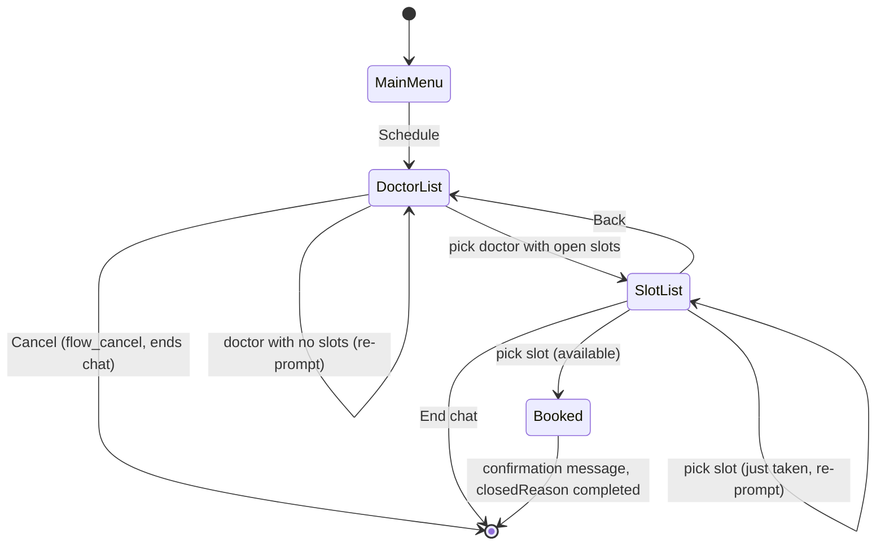
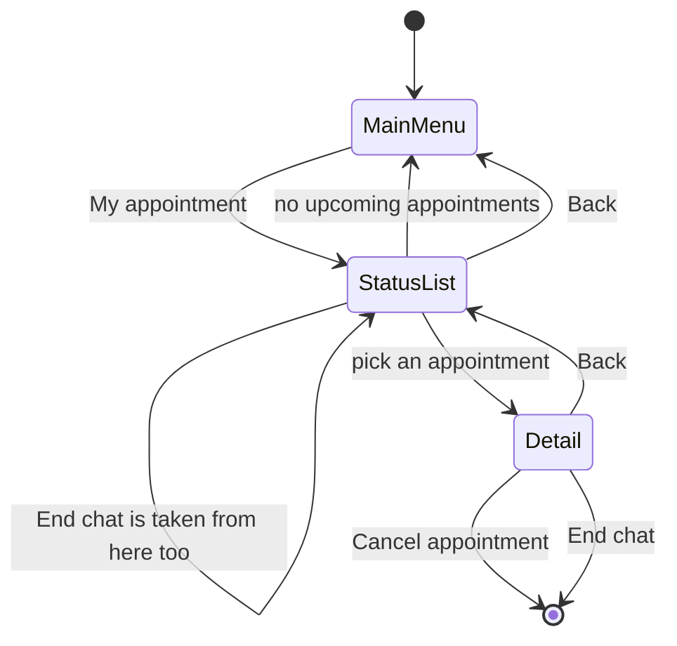
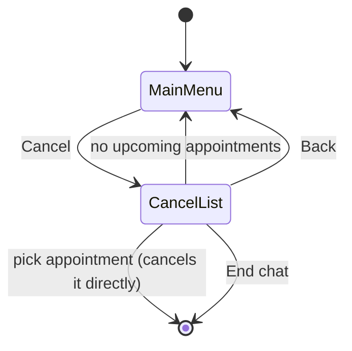

# WhatsApp Chat Flows (MongoDB path)

> Scope: the automated MongoDB-backed conversation driven by [`chatflow.service.ts`](../src/services/chatflow.service.ts).
> The legacy Google Sheets flow ([`chatflow.spreadsheet.service.ts`](../src/services/chatflow.spreadsheet.service.ts)) is a
> separate, linear data-collection script and is intentionally out of scope — see [Google Sheets flow](#google-sheets-flow-out-of-scope) at the end.

This document is the source of truth for the conversation design. Code must match it; when they
diverge, fix the code (or update this document first, then the code, in the same change).

## Status

**Design accepted, not yet implemented.** This describes the target behavior. The current code still
has the issues listed in [Known issues in the current code](#known-issues-in-the-current-code).

## Global rules

These apply to every step below unless a step says otherwise.

- **Three possible outcomes per flow**: reach a result (booked / viewed / cancelled), go **Back**, or
  **End chat**. Every step offers at least one of these.
- **End chat** (`end_chat`) always closes the conversation immediately, from any step, with the message
  *"Chat finished. Send any message to start again."* and `closedReason: completed`. It never asks for
  confirmation.
- **Terminology**: **"Cancel"** only ever means *cancel an appointment*. **"End chat"** only ever means
  *end the conversation*. These are never the same button.
  - **Accepted exception** (left as-is, not touched by this redesign): the doctor list's exit row is
    still labeled **"Cancel"** (id `flow_cancel`) even though it ends the chat rather than cancelling an
    appointment, because no appointment exists yet at that point. It behaves like `end_chat` but keeps
    its current message *"Request cancelled. Send any message to start again."* and `closedReason:
    cancelled`. This is intentional and documented here so it isn't "fixed" by mistake later.
- **No free-text shortcuts**: there is no typed keyword (e.g. "cancelar") that ends the conversation.
  Ending or cancelling only happens by tapping a button or list row. (This removes the current
  `isCancelInput` / `cancelar` keyword handling.)
- **Invalid input**: one retry. The bot re-sends the exact same prompt with a generic "I didn't
  understand that" prefix. A second invalid input in a row closes the conversation silently
  (`closedReason: invalid_input`, no message sent).
- **Inactivity timeout**: 10 minutes. The next inbound message starts a brand-new conversation at
  `start`, instead of resuming the old one.
- **Unhandled errors**: the conversation closes with `closedReason: error` and the bot sends a generic
  "something went wrong" message.
- **WhatsApp limits**: interactive button messages support at most 3 buttons; list messages support at
  most 10 rows total (`MAX_LIST_ROWS`).
- **Appointment lists are capped at 5 items** ("My appointments" and "Cancel" lists). This is a product
  decision (keep the list short and scannable), not a WhatsApp limit — there is still room for more rows
  under the 10-row cap, but only the next 5 upcoming appointments are shown.

## States (`FLOW_STEPS`)

| Step | Meaning |
|---|---|
| `start` | No active conversation yet; any inbound message shows the main menu. |
| `awaiting_choice` | Main menu is shown (Schedule / My appointment / Cancel). |
| `awaiting_doctor` | Doctor list is shown (Agendar). |
| `awaiting_appointment` | Time-slot list for the chosen doctor is shown (Agendar). |
| `awaiting_status_list` | "My appointments" list is shown (Revisar estado). |
| `awaiting_status_detail` | **New.** One appointment's detail and actions are shown (Revisar estado). |
| `awaiting_cancel_appointment` | List of appointments to cancel is shown (Cancelar). |

Removed from the current code: `awaiting_cancel_action` (the intermediate "what do you want to do"
menu between picking "Cancel" on the main menu and seeing the cancel list). It added clicks without
adding a decision the user actually needs to make, so it is removed — "Cancel" on the main menu goes
straight to the cancel list.

## Button/row IDs

| ID | Appears in | Meaning |
|---|---|---|
| `schedule_app` | Main menu | Start Agendar |
| `check_status` | Main menu | Start Revisar estado |
| `cancel` | Main menu | Start Cancelar |
| `doctor_<id>` | Doctor list | Pick a doctor with open slots |
| `nodoc_<id>` | Doctor list | Doctor with no open slots (re-prompts) |
| `flow_cancel` | Doctor list only | Exception: ends the chat, labeled "Cancel" (see Global rules) |
| `appointment_<id>` | Slot list | Pick a time slot to book |
| `slot_back` | Slot list | **New.** Back to the doctor list |
| `end_chat` | Everywhere except the doctor list | **New.** Ends the chat |
| `status_appt_<id>` | My appointments list | Open one appointment's detail |
| `status_back` | My appointments list | Back to main menu |
| `status_detail_cancel` | Appointment detail | **New.** Cancel this specific appointment directly |
| `status_detail_back` | Appointment detail | **New.** Back to the appointments list |
| `cancel_<id>` | Cancel list | Cancel this specific appointment directly |
| `cancel_back` | Cancel list | Back to main menu (renamed from today's `cancel_exit`) |

## Flow 1 — Agendar (Schedule an appointment)

| Step | User input | Bot response | Next step |
|---|---|---|---|
| `awaiting_choice` | `schedule_app` | List of doctors with open slots (up to 9 rows) + `flow_cancel` row ("Cancel") | `awaiting_doctor` |
| `awaiting_doctor` | `doctor_<id>` (has slots) | List of that doctor's free time slots (up to 8 rows) + `slot_back` ("Back") + `end_chat` ("End chat") | `awaiting_appointment` |
| `awaiting_doctor` | `nodoc_<id>` (no slots) | "That doctor has no open slots. Please choose another doctor:" + doctor list again | `awaiting_doctor` |
| `awaiting_doctor` | `flow_cancel` | "Request cancelled. Send any message to start again." (`closedReason: cancelled`) | `start` |
| `awaiting_doctor` | no doctors at all exist | "There are no doctors available at the moment..." (`closedReason: completed`) | `start` |
| `awaiting_appointment` | `appointment_<id>` (still free) | Booking confirmation with date/doctor (`closedReason: completed`) | `start` |
| `awaiting_appointment` | `appointment_<id>` (already taken) | "That time slot is no longer available. Please choose another one:" + fresh slot list | `awaiting_appointment` |
| `awaiting_appointment` | `slot_back` | Doctor list again | `awaiting_doctor` |
| `awaiting_appointment` | `end_chat` | "Chat finished. Send any message to start again." (`closedReason: completed`) | `start` |

## Flow 2 — Revisar estado (Check my appointments)

| Step | User input | Bot response | Next step |
|---|---|---|---|
| `awaiting_choice` | `check_status` | Expires past appointments, then: next 5 upcoming appointments (rows `status_appt_<id>`) + `status_back` ("Back") + `end_chat` ("End chat") | `awaiting_status_list` |
| `awaiting_choice` | `check_status`, zero upcoming appointments | "You have no upcoming appointments.\n\nWhat would you like to do?" + main menu buttons | `awaiting_choice` |
| `awaiting_status_list` | `status_appt_<id>` (still exists) | Saves `selectedAppointment = <id>`. Shows "Your appointment is on {date} with {doctor}." + buttons `status_detail_cancel` ("Cancel appointment") / `status_detail_back` ("Back") / `end_chat` ("End chat") | `awaiting_status_detail` |
| `awaiting_status_list` | `status_appt_<id>` (no longer exists) | "That appointment is no longer available. Here are your upcoming appointments:" + fresh list | `awaiting_status_list` |
| `awaiting_status_list` | `status_back` | Main menu | `awaiting_choice` |
| `awaiting_status_list` | `end_chat` | "Chat finished..." (`closedReason: completed`) | `start` |
| `awaiting_status_detail` | `status_detail_cancel` | Cancels `selectedAppointment` directly. "Your appointment on {date} has been cancelled." (`closedReason: completed`) | `start` |
| `awaiting_status_detail` | `status_detail_cancel`, appointment no longer exists | "That appointment is no longer available." + fresh appointments list | `awaiting_status_list` |
| `awaiting_status_detail` | `status_detail_back` | Appointments list again (fresh) | `awaiting_status_list` |
| `awaiting_status_detail` | `end_chat` | "Chat finished..." (`closedReason: completed`) | `start` |

**Deliberately removed:** "Schedule" is no longer offered from an appointment's detail. A user cannot
rebook or change the date of an existing appointment from here — if they picked the wrong one, they
must cancel it (one tap) and start a new Agendar flow from the main menu.

**Bug this fixes:** today, the detail screen reuses the `awaiting_choice` step with different buttons
than the main menu. If the user sends an invalid reply there, the re-prompt (`promptFor`) falls back to
the main menu's buttons instead of the detail's buttons, because both share the same step name. The new
dedicated `awaiting_status_detail` step removes this bug.

## Flow 3 — Cancelar (Cancel an appointment)

| Step | User input | Bot response | Next step |
|---|---|---|---|
| `awaiting_choice` | `cancel` | Expires past appointments, then: next 5 upcoming appointments (rows `cancel_<id>`) + `cancel_back` ("Back") + `end_chat` ("End chat") | `awaiting_cancel_appointment` |
| `awaiting_choice` | `cancel`, zero upcoming appointments | "You have no upcoming appointments to cancel." + main menu buttons | `awaiting_choice` |
| `awaiting_cancel_appointment` | `cancel_<id>` (still exists) | Cancels directly. "Your appointment on {date} has been cancelled." (`closedReason: completed`) | `start` |
| `awaiting_cancel_appointment` | `cancel_<id>` (already cancelled/gone) | "That appointment could not be cancelled. Please choose one from the list:" + fresh list | `awaiting_cancel_appointment` |
| `awaiting_cancel_appointment` | `cancel_back` | Main menu | `awaiting_choice` |
| `awaiting_cancel_appointment` | `end_chat` | "Chat finished..." (`closedReason: completed`) | `start` |

**Deliberately removed:** the current intermediate "what do you want to do" menu
(`awaiting_cancel_action`, with its own "Cancel appointment / End chat / Back" buttons) between picking
"Cancel" on the main menu and seeing the list of appointments. Picking "Cancel" goes straight to the
list. This is also what the appointment detail in Flow 2 now does directly, instead of routing through
this menu and re-listing every appointment again.

## Known issues in the current code

These are the concrete problems found while auditing [`chatflow.service.ts`](../src/services/chatflow.service.ts);
each is resolved by the design above.

1. Cancelling an appointment you're already viewing (via "My appointments") takes 3–4 extra taps: detail
   → action menu → "Cancel appointment" → pick the same appointment again from a re-listed, full list.
   **Fixed**: the detail screen cancels that exact appointment in one tap.
2. The appointment-detail screen and the main menu share the same `awaiting_choice` step name but show
   different buttons, so an invalid-input re-prompt there shows the wrong (main menu) buttons. **Fixed**
   by the new `awaiting_status_detail` step.
3. The slot list's only non-booking option is a "Cancel" row that just ends the chat, with no way to go
   back to the doctor list. **Fixed**: adds `slot_back` and renames the end action to `end_chat`.
4. Selecting "Cancel" on the main menu silently calls `cancelPastAppointments` and routes through an
   extra actions menu before showing any appointment. **Fixed**: goes directly to the cancel list.
5. An empty appointments list (status or cancel) closes/dead-ends the conversation instead of offering
   next steps. **Fixed**: both route back to the main menu with an explanatory message.
6. "Cancel" is overloaded: it means "end the chat" in the doctor list but "cancel an appointment"
   everywhere else. **Fixed** going forward by using `end_chat` for every new exit point; the doctor
   list's existing `flow_cancel` row is kept as a documented, deliberate exception.
7. Typing the free-text word "cancelar" ends the conversation from anywhere, which is an undiscoverable,
   undocumented shortcut with no equivalent UI affordance. **Removed**: ending or cancelling only
   happens through an explicit button or list row tap.

## Data model impact

Implementing `awaiting_status_detail` requires remembering which appointment is open, the same way
`selectedDoctor` already tracks the chosen doctor during Agendar. A `selectedAppointment: string | null`
field needs to be added alongside `selectedDoctor` in the conversation snapshot, the advance payload, and
the `Conversation` schema/types. This is a data-model change, not just a UI change, and is tracked
separately in the implementation plan.

## Google Sheets flow (out of scope)

[`chatflow.spreadsheet.service.ts`](../src/services/chatflow.spreadsheet.service.ts) implements a
separate, linear, single-path intake script (name → insurance → insurance number → preferred date/time →
hand-off to a human via a Google Sheet row). It has no menu, no back navigation, and only a free-text
"cancelar" keyword to abort. It is not part of the MongoDB flow redesign above and is not changed by it.
